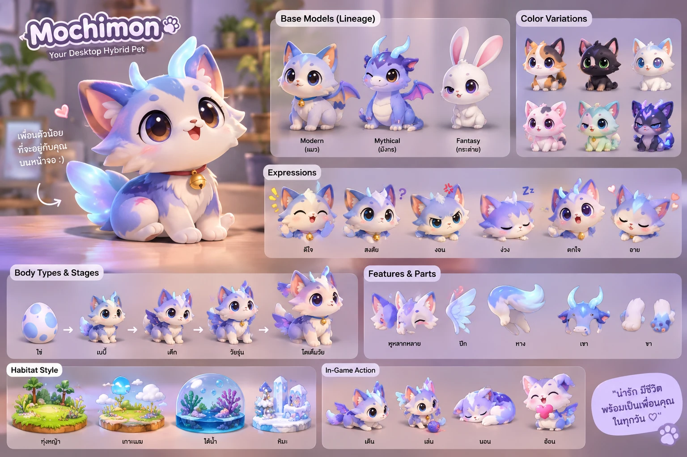

# Art Direction — "ตุ๊กตาขนฟู"

ภาพอ้างอิงเป้าหมาย: [`reference/style-sheet.webp`](reference/style-sheet.webp)

## สิ่งที่ถอดจากภาพอ้างอิง

| หัวข้อ       | ลักษณะ                                                   | วิธีทำด้วยโค้ด                                          | สถานะ                     |
| ---------- | ------------------------------------------------------- | --------------------------------------------------- | ------------------------- |
| สัดส่วน      | ชิบิ หัว ≈ ครึ่งตัว ขาสั้นป้อม ท่านั่งเป็นท่าหลัก                      | `composeBody` + ท่า `sit` ใน rig                     | ทำแล้ว                     |
| ผิว/แสง     | นุ่ม ไม่มีเส้นขอบ เงาอมม่วง ขอบสว่าง                           | `material/plush.ts` (half-lambert + rim + AO ที่อบไว้) | ทำแล้ว                     |
| ขน         | ฟูเป็นปุย ขอบตัวนุ่ม                                          | shell fur (วาดผิวซ้ำ 6–12 ชั้น) + ปอยขนแก้ม/อก           | ทำแล้ว — **ยังหยาบกว่าภาพ**  |
| ตา         | โตมาก ม่านตาไล่สี ประกายหลายจุด ขอบเข้ม                      | shader บนแผ่นโค้งแนบหัว (`material/face.ts`)           | ทำแล้ว                     |
| ปาก/จมูก    | จมูกสามเหลี่ยมเล็ก ปาก ω / ยิ้มอ้า                             | shader บนแผ่นแนบจมูก                                  | ทำแล้ว                     |
| สี          | ขาวเป็นหลัก + ลายแต้มพาสเทล (หมวก ผ้าคลุมหลัง ปลายหาง) หูในชมพู | ยีนส์ `marking.*`, `color.mark`, `color.inner`        | ทำแล้ว                     |
| เขา/ปีก     | โปร่งเรืองแสงฟ้า                                           | ยีนส์ `glow.level` + วัสดุเรืองแสง                       | ทำแล้ว (ทึบแสง ยังไม่โปร่งจริง) |
| เครื่องประดับ | ปลอกคอแดง กระดิ่งทอง                                      | ตัวเลือก `collar` (ไม่ใช่ยีนส์)                           | ทำแล้ว                     |
| สีหน้า       | ดีใจ สงสัย งอน ง่วง ตกใจ อาย + ไอคอนลอย                    | พารามิเตอร์ตา/ปาก (`anim/expression.ts`)              | สีหน้าทำแล้ว, ไอคอนลอยยังไม่ทำ |
| ช่วงวัย      | ไข่ลายจุด → เบบี้ → เด็ก → วัยรุ่น → โต                         | `composeBody`                                       | ยังไม่มีไข่                   |
| ท่าทาง      | เดิน เล่นลูกบอล นอนขด อ้อน                                  | pose blending                                       | มี ยืน/นั่ง/หมอบ/นอนขด/เดิน    |
| ฉาก        | ทุ่งหญ้า เกาะเมฆ ใต้น้ำ หิมะ                                  | `packages/habitat`                                  | ยังไม่ทำ                    |

## ข้อจำกัดที่ยอมรับ

ภาพอ้างอิงเป็นงานเรนเดอร์ระดับภาพวาด: เส้นขนทีละเส้น แสงสะท้อนรอบทิศ พื้นหลังเบลอ
ตัวสัตว์ในเกมสร้างด้วยโค้ดและวาดแบบ real-time บนหน้าต่างโปร่งใส จึงตั้งเป้าที่ "อารมณ์เดียวกัน" ไม่ใช่เหมือนทุกพิกเซล

จุดที่ยังห่างจากภาพอ้างอิงมากที่สุด ณ ตอนนี้:

1. **เนื้อขน** — ยังเป็นเม็ดหยาบ ไม่เนียนเป็นปุยแบบภาพ
2. **หาง** — เล็กและมองเห็นยากจากด้านหน้า
3. **ปริมาตรลำตัว** — ลำตัว/ขายังกลืนกันเป็นก้อนขาว
4. **ความโปร่งของเขา/ปีก** — ยังทึบ

## ตัวเอก "โมจิ"

`createMochi()` ใน `packages/core/src/genetics/presets.ts`: ลูกผสมแมว×มังกร ขนขาว-ลาเวนเดอร์ เขาฟ้าเรืองแสง
ปีกขนนกเล็ก หางฟู สัญลักษณ์ดาวที่สะโพก — เป็นสัตว์ตัวแรกของผู้เล่นและไอคอนแอป

## หลักการ procedural

- **ไม่มีไฟล์โมเดล** ทุกชิ้นสร้างจากพารามิเตอร์ของ allele → ผสมได้ไม่จำกัดและปรับรูปร่างตามการเลี้ยงได้ลื่นไหล
- ชิ้นส่วนเป็น mesh แยกบน rig เดียวกัน แต่หลอมรอยต่อด้วยสนาม SDF (`build/field.ts`) ให้ดูเป็นเนื้อเดียว
- ลวดลายและสีคำนวณจาก**ตำแหน่งในท่าพัก**ที่อบไว้ต่อ vertex จึงไม่ไหลตอนขยับ และต่อเนื่องข้ามชิ้นส่วน
- เปิดช่องไว้สำหรับชิ้นส่วน GLB ปั้นมือในอนาคต (แทนที่ตัวสร้างของ allele นั้นๆ)
